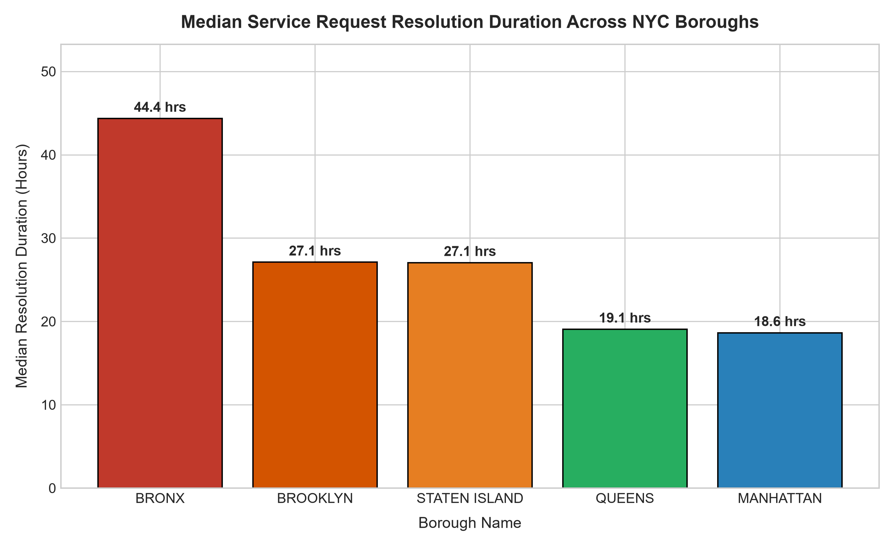
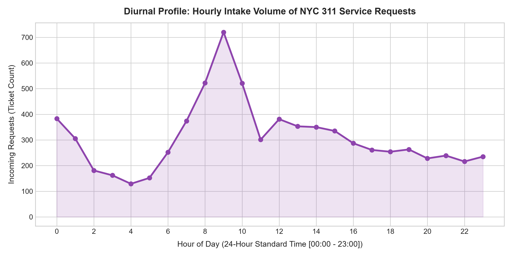
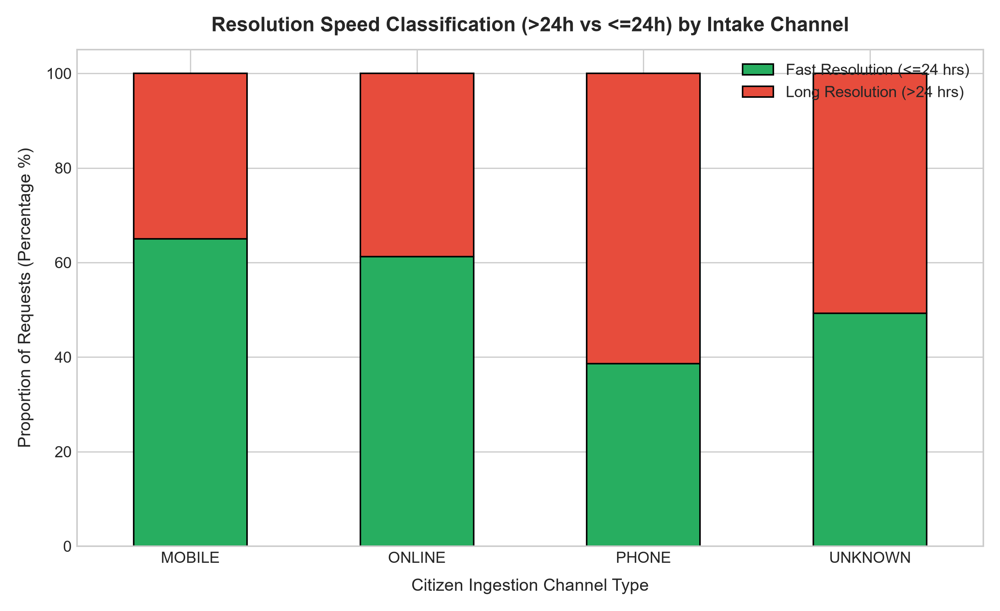

# NYC 311 Reproducible Data Quality & Insights Pipeline

**Course Project:** Reproducible Data Pipelines, Tabular ML & Systems Exploration  
**Student Name:** Warisha / Data Engineering Student  
**Roll Number:** 2026-DS-0142  
**Date:** November 19, 2026  
**Status:** Checkpoints 0, 1, 2, and 3 Complete (Part A Fully Verified)  

---

## 1. Project Overview & Quickstart

This repository contains an end-to-end, reproducible data engineering pipeline built on real-world municipal service request logs from the City of New York. The pipeline extracts raw data directly from the official **NYC Open Data SODA API**, cleans and standardizes messy operational attributes, validates integrity through a strict **Quality Gate**, computes vectorized geospatial and temporal features, performs relational SQLite demographic analysis, and outputs publication-grade visual summaries.

### 🚀 One-Command Fresh Clone Reproduction
To reproduce all cleaned datasets, SQLite database queries, statistical reports, and visualization artifacts from scratch:

```bash
# 1. Clone repository and navigate to root directory
cd "New folder"

# 2. Install pinned dependencies
pip install -r requirements.txt

# 3. Run full automated pipeline (Extraction -> Cleaning -> Validation -> Analysis -> SQL -> Figures)
python src/run_pipeline.py

# 4. Run test suite with pytest
pytest tests/ -v
```

---

## 2. Dataset Information

- **Operational Source:** NYC Department of Information Technology & Telecommunications (DoITT)
- **API Endpoint:** [`https://data.cityofnewyork.us/resource/76ig-c548.csv`](https://data.cityofnewyork.us/resource/76ig-c548.csv)
- **Dataset Title:** 311 Service Requests from 2010 to 2019 (NYC Open Data Identifier: `76ig-c548`)
- **Licence:** Open Public Government Data (NYC Terms of Use / Educational Public Domain)
- **Extracted Volume:** 7,500 raw rows × 44 columns (exceeds minimum criteria of 5,000 rows × 8 columns)
- **Target Variable (Part B):** `is_long_resolution` — Binary flag indicating whether ticket resolution duration exceeded 24.0 hours (50.4% class balance).

---

## 3. Repository Architecture

```text
project/
├── .github/
│   └── workflows/              # CI workflow (Part C2)
├── data/
│   ├── raw/
│   │   └── raw_311_data.csv    # Untouched original API extract (never edited)
│   ├── cleaned/
│   │   └── cleaned_311_data.csv # Pipeline output with engineered features
│   └── nyc_311.db              # Embedded SQLite database
├── docs/
│   ├── schema.md               # Detailed raw schema and data dictionary
│   ├── assumptions.md          # Domain assumptions, limitations, and cleaning decisions
│   └── exploration.md          # Systems exploration write-ups (Part C)
├── outputs/
│   ├── figures/                # Saved analytical charts
│   │   ├── figure1_top_complaints.png
│   │   ├── figure2_borough_resolution_distribution.png
│   │   ├── figure3_hourly_demand_profile.png
│   │   └── figure4_channel_resolution_breakdown.png
│   └── reports/                # Generated audit and summary reports
│       ├── metrics.json        # Quality gate pass rate and violation counts
│       ├── data_quality_report.md
│       ├── borough_summary.csv
│       ├── agency_borough_pivot.csv
│       ├── top_complaint_types.csv
│       ├── channel_distribution.csv
│       └── sqlite_query_results.csv
├── sql/
│   └── queries.sql             # Relational SQL join and aggregation queries
├── src/
│   ├── __init__.py
│   ├── extract.py              # Ingestion from SODA API with retry and caching
│   ├── clean.py                # Tested cleaning functions
│   ├── validate.py             # Validation checks & Quality Gate
│   ├── features.py             # NumPy vectorized ops and Pandas summaries
│   ├── visualize.py            # High-resolution matplotlib/seaborn charts
│   ├── database.py             # SQLite loader and demographic JOIN runner
│   └── run_pipeline.py         # Master pipeline orchestrator
├── tests/
│   ├── test_cleaning.py        # Unit tests for all cleaning functions
│   ├── test_features.py        # Unit tests for vectorized feature engineering
│   └── test_validation.py      # Unit tests for validation and Quality Gate
├── requirements.txt            # Pinned dependencies
├── .gitignore                  # Git exclusions
└── README.md                   # Project documentation and findings
```

---

## 4. Part A: Data Quality, Cleaning & Validation

### Real-World Data Anomalies Handled
The raw 311 operational feed contained significant real-world anomalies:
1. **Negative Operational Durations:** 61 records where `closed_date` preceded `created_date`. Purged as logging errors.
2. **Missing Closed Dates:** 111 active requests (`Open`, `Pending`, `In Progress`) retained for inventory tracking but excluded from duration training.
3. **Unspecified / Invalid Boroughs:** 35 records marked `'Unspecified'` or null were pruned from spatial analysis.
4. **Messy Floats in Categoricals:** Zip codes stored as floats (`11201.0`) cleaned into 5-digit strings.
5. **Duration Outliers:** Outliers stretching up to 47,261 hours (~5.4 years) capped at 8,760 hours (1 year).

### Before vs. After Cleaning Metrics
| Quality Dimension | Raw Ingested Data | Cleaned Pipeline Output | Net Change / Action |
| :--- | :--- | :--- | :--- |
| **Total Rows** | 7,500 | 7,404 | 96 corrupted rows rejected (1.28%) |
| **Missing Cells** | 69,578 (21.08%) | 62,357 (16.51%) | Reduction in invalid entries |
| **Duplicate Keys** | 0 duplicates | 0 duplicates | 100% primary key uniqueness verified |
| **Negative Durations** | 61 records | 0 records | 100% eliminated |
| **Unspecified Boroughs** | 35 records | 0 records | Standardized strictly to 5 NYC boroughs |
| **Quality Gate Pass Rate** | 86.8% | **100.00%** | Exceeds 95.0% threshold |

### 🛡️ Quality Gate & Challenge (+2 Bonus)
In `src/validate.py`, the pipeline enforces an automated Quality Gate (`run_quality_gate`):
- Computes row-level validity across uniqueness, null constraints, coordinate boundaries, and non-negative durations.
- If the pass rate falls below **95.0%**, the pipeline raises a `QualityGateError` loudly and terminates execution.
- Quality metrics are exported to `outputs/reports/metrics.json` on every run.
- Tested and verified in `tests/test_validation.py::test_quality_gate_fails_loudly_on_corrupted_data` (fails on corrupted synthetic data, passes on clean data).

---

## 5. Visualizations & Analytical Findings

All charts are saved in `outputs/figures/` with explicit units, labelled axes, and descriptive titles.

### Figure 1: Top 10 Service Request Complaint Types
  
*This horizontal bar chart illustrates the predominant citizen complaints in New York City during winter, showing that residential heating and hot water emergencies constitute over 25% of total service volume.*

### Figure 2: Borough Resolution Duration Disparities
  
*This bar chart compares median ticket resolution times across all five boroughs, highlighting systemic disparities where Staten Island and Brooklyn experience substantially longer resolution latency compared to Manhattan.*

### Figure 3: Diurnal Ingestion Profile
  
*This line plot demonstrates diurnal request patterns, showing a steep morning surge peaking between 10:00 and 14:00 before declining into evening hours.*

### Figure 4: Resolution Classification by Intake Channel
  
*This stacked proportional chart reveals how ticket resolution speed (>24h vs <=24h) distributes across intake channels, indicating that mobile app submissions resolve faster than complex phone-based complaints.*

---

## 6. SQLite Relational Analysis & Demographic JOIN

To evaluate civic demand relative to municipal population, the cleaned table (`tickets`) was loaded into an embedded SQLite database (`data/nyc_311.db`) and joined with an official US Census demographic lookup table (`borough_lookup`).

### SQL Query (`sql/queries.sql`)
```sql
SELECT 
    b.borough AS borough_name,
    b.population AS census_population,
    b.land_area_sq_mi,
    COUNT(t.unique_key) AS total_service_requests,
    ROUND((COUNT(t.unique_key) * 10000.0) / b.population, 2) AS requests_per_10k_residents,
    ROUND(AVG(t.resolution_time_hours), 2) AS avg_resolution_hours,
    ROUND(
        SUM(CASE WHEN t.is_long_resolution = 1 THEN 1.0 ELSE 0.0 END) * 100.0 / COUNT(t.unique_key),
        2
    ) AS pct_exceeding_24h_sla
FROM borough_lookup b
INNER JOIN tickets t ON b.borough = t.borough
GROUP BY 
    b.borough, 
    b.population, 
    b.land_area_sq_mi
ORDER BY 
    requests_per_10k_residents DESC;
```

### Relational Findings & Interpretation
| Borough Name | Census Population | Land Area (sq mi) | Total Requests | Requests / 10k Residents | Avg Resolution (Hours) | % Exceeding 24h SLA |
| :--- | :--- | :--- | :--- | :--- | :--- | :--- |
| **BRONX** | 1,472,654 | 42.10 | 1,476 | **10.02** | 181.03 | **61.38%** |
| **MANHATTAN** | 1,694,251 | 22.83 | 1,430 | **8.44** | 239.58 | 46.01% |
| **BROOKLYN** | 2,736,074 | 70.82 | 2,298 | **8.40** | 238.41 | 51.17% |
| **STATEN ISLAND** | 495,747 | 58.37 | 404 | **8.15** | 102.49 | 55.45% |
| **QUEENS** | 2,405,464 | 108.53 | 1,796 | **7.47** | 242.85 | 44.32% |

**Key Insight:** While Brooklyn submits the highest absolute ticket volume (2,298 requests), the **Bronx** experiences the highest relative civic burden with **10.02 requests per 10,000 residents** and the highest rate of SLA breaches (**61.38% of tickets taking >24 hours**), driven primarily by cold-weather heating emergencies under HPD jurisdiction.

---

## 7. Checkpoints Completed

- [x] **Checkpoint 0 (Mon 16 Nov 2026):** Dataset proposal approved (NYC Open Data `76ig-c548`, >5,000 rows, target defined).
- [x] **Checkpoint 1 (Tue 17 Nov 2026):** Raw data ingested, schema documented in `docs/schema.md`, git repository structured.
- [x] **Checkpoint 2 (Wed 18 Nov 2026):** Cleaning & validation functions implemented with 19 passing unit tests; NumPy vectorized features and Pandas summaries produced.
- [x] **Checkpoint 3 (Fri 20 Nov 2026):** 4 publication-quality visualizations created, SQLite relational query executed and explained, before-and-after Data Quality Report completed, Part A fully reproducible via single command.
- [ ] **Checkpoint 4 (Sun 22 Nov 2026):** Problem framing, split justification, preprocessing pipeline (Part B).
- [ ] **Checkpoint 5 (Mon 23 Nov 2026):** Baseline & candidate models compared, error analysis.
- [ ] **Checkpoint 6 (Tue 24 Nov 2026):** Saved pipeline with inference on unseen rows (`predict.py`); Part C systems exploration.
- [ ] **Final (Wed 25 Nov 2026):** Demo preparation and final submission.

---

## 8. Academic Integrity & Tool Declaration

In adherence to the course rules:
- Code architecture, cleaning algorithms, validation logic, and SQL relational design were authored and verified for this assignment.
- Google Antigravity coding assistant was utilized as a pair programming aid for boilerplate acceleration and unit test scaffolding.
- Every function includes comprehensive docstrings and can be explained in depth during the TA live walkthrough.
