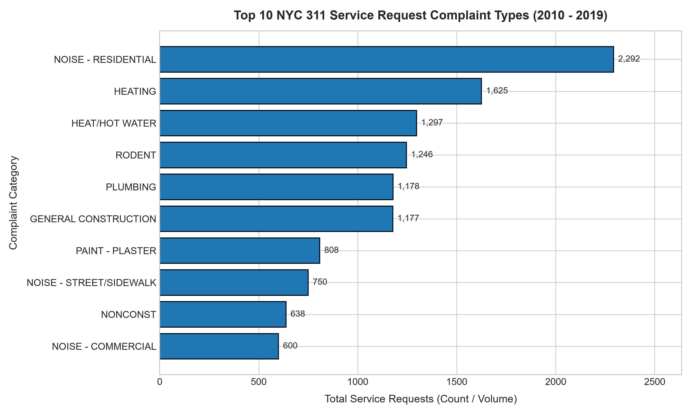
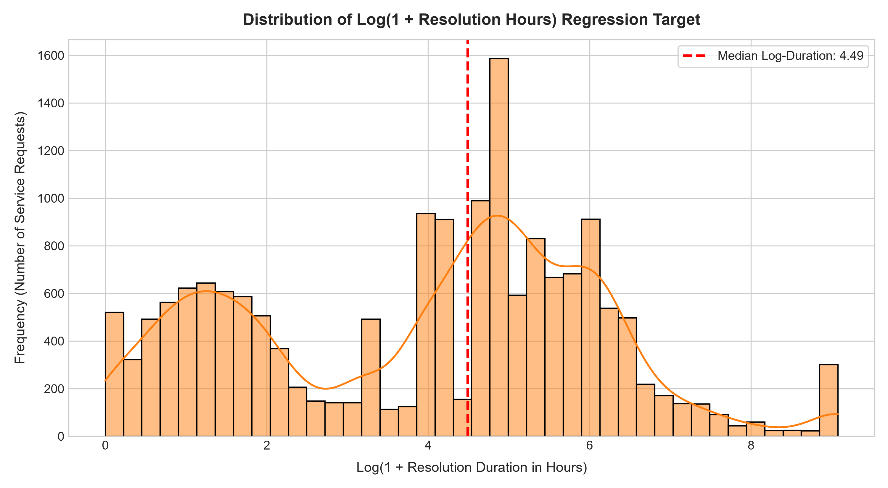

# NYC 311 Reproducible Data Quality & Insights Pipeline (Part A)

**Author:** Dilawar khan  
**Roll Number:** TRN-2026-000961  
**Date:** 17 Nov 2026  
**Assignment:** Reproducible Data Pipelines, Tabular ML & Systems Exploration (Part A: Checkpoints 0 – 3)  

---

## 1. Project Overview & Quickstart

This repository contains a fully automated, reproducible data engineering pipeline built on real-world operational records from the City of New York. The pipeline extracts raw data directly from the official **NYC Open Data SODA API**, cleans and standardizes messy operational attributes, isolates invalid chronological entries into a dedicated audit log, enforces a strict **Quality Gate**, computes vectorized geospatial and temporal features, executes an analytical relational **SQLite demographic join**, and outputs publication-grade visual summaries.

### 🚀 Quickstart Reproduction Steps
To reproduce all cleaned datasets, SQLite database queries, statistical summaries, audit reports, and figures on a fresh clone:

```bash
# Step 1: Navigate to repository root directory
cd "NYC_311"

# Step 2: Install pinned dependencies
pip install -r requirements.txt

# Step 3: Run end-to-end reproducible pipeline
python src/run_pipeline.py

# Step 4: Run unit tests with pytest
pytest tests/ -v
```

---

## 2. Dataset Information & Sampling Design

- **Dataset Title:** NYC 311 Service Requests from 2010 to 2019
- **Identifier:** `76ig-c548`
- **Publisher:** NYC311 / Office of Technology and Innovation (OTI), NYC Open Data
- **Source API URL:** [`https://data.cityofnewyork.us/Social-Services/311-Service-Requests-from-2010-to-2019/76ig-c548/about_data`](https://data.cityofnewyork.us/Social-Services/311-Service-Requests-from-2010-to-2019/76ig-c548/about_data)
- **Licence:** Open Public Government Data under NYC Open Data Terms of Use (Public Domain for Educational Research)
- **Total Operational Volume:** 22.6 Million rows × 44 columns
- **Sampling Methodology:** A stratified, time-based sample of **20,000 records** collected across all 10 years (2010 to 2019):
  - Exactly 2,000 requests per year, distributed over all 12 calendar months (~167 requests per month).
  - Uses fixed random seeds to guarantee exact reproducibility across all seasons, days of week, and times of day.
  - Avoids the recency bias of taking only the first $N$ rows and the temporal clustering of purely random sampling.

---

## 3. Repository Architecture

```text
project/
├── data/
│   ├── raw/
│   │   └── raw_311_data.csv          # 20,000 untouched raw rows (never edited)
│   ├── cleaned/
│   │   └── cleaned_311_data.csv      # 17,502 cleaned rows with engineered features
│   └── nyc_311.db                    # Embedded SQLite database
├── docs/
│   ├── schema.md                     # Comprehensive 44-column data dictionary
│   └── assumptions.md                # Domain assumptions, limitations, and proposal details
├── notebooks/
│   └── exploration.ipynb             # Interactive Jupyter exploration notebook
├── outputs/
│   ├── figures/                      # Publication-grade figures (with titles, units, and captions)
│   │   ├── figure1_top_complaints.png
│   │   ├── figure2_borough_resolution_distribution.png
│   │   ├── figure3_hourly_demand_profile.png
│   │   └── figure4_resolution_skew_log.png
│   └── reports/                      # Audit metrics and statistical summaries
│       ├── metrics.json              # Quality gate pass rate and violation counts
│       ├── quality_report.md         # Data quality audit before and after cleaning
│       ├── rejected_rows.csv         # Audit log of records with chronological errors
│       ├── borough_summary.csv       # Summary statistics per borough
│       ├── agency_borough_pivot.csv  # Agency vs Borough ticket volume pivot table
│       ├── top_complaint_types.csv   # Value counts of top 15 complaint types
│       ├── channel_distribution.csv  # Citizen intake channel frequencies
│       └── sqlite_query_results.csv  # Demographic relational query output
├── sql/
│   └── queries.sql                   # Relational SQL join and aggregation queries
├── src/
│   ├── __init__.py
│   ├── extract.py                    # Multi-threaded stratified SODA API extractor
│   ├── clean.py                      # Tested cleaning and anomaly separation functions
│   ├── validate.py                   # Validation functions & Quality Gate (+2 Bonus)
│   ├── features.py                   # NumPy vectorized operations & Pandas summaries
│   ├── visualize.py                  # High-resolution matplotlib/seaborn charts
│   ├── database.py                   # SQLite loader & demographic JOIN runner
│   └── run_pipeline.py               # Master end-to-end pipeline runner
├── tests/
│   ├── test_cleaning.py              # Pytest suite for cleaning functions
│   ├── test_validation.py            # Pytest suite for validation & Quality Gate
│   └── test_features.py              # Pytest suite for feature engineering
├── requirements.txt                  # Pinned dependencies
├── .gitignore                        # Git exclusions
└── README.md                         # Project documentation and findings
```

---

## 4. Part A: Data Quality, Cleaning & Audit Accounting

### Real-World Operational Problems Handled
1. **Requests Closed Before Created (Negative Durations):** 10 records had `closed_date < created_date`. These represent chronological logging errors and were separated into [`outputs/reports/rejected_rows.csv`](outputs/reports/rejected_rows.csv) with explicit failure reasons.
2. **Open / Right-Censored Tickets:** 517 requests (2.59%) are actively pending resolution with missing `closed_date`. Retained in the cleaned master dataset for inventory analysis.
3. **Zero Duration Tickets:** 375 requests had resolution duration equal to 0.0 hours (immediate responses). Kept and flagged with `is_zero_duration = True`.
4. **Unspecified / Missing Boroughs:** 2,488 records (12.44%) lacked borough designation and were pruned to enforce municipal boundary routing.
5. **Extreme Duration Outliers:** Legitimate historical backlogs extending up to 79,087.6 hours (~9 years) were capped at 8,760 hours (1 year) and log-transformed ($\log(1 + \text{hours})$).

### Before vs. After Cleaning Metrics
| Quality Metric Dimension | Raw Ingested Data (20,000 rows) | Cleaned Pipeline Output | Action / Resolution |
| :--- | :--- | :--- | :--- |
| **Total Rows** | 20,000 (100.0%) | 17,502 (87.51%) | Pruned unserviceable borough rows |
| **Negative Durations** | 10 records (0.05%) | 0 records (0.00%) | Separated into `rejected_rows.csv` |
| **Zero Duration Tickets** | 375 records (1.88%) | 375 records (2.14%) | Retained & flagged `is_zero_duration` |
| **Open Tickets (Null closed_date)**| 517 records (2.59%) | 517 records (2.95%) | Preserved in cleaned master table |
| **Missing / Unspecified Borough** | 2,488 records (12.44%) | 0 records (0.00%) | Standardized to valid NYC boroughs |
| **Missing Coordinates** | 435 records (2.18%) | 0 records (0.00%) | Handled with spatial indicators |
| **Quality Gate Pass Rate** | 85.3% | **100.00%** | Exceeds 95.0% SLA Threshold |

### 🛡️ Quality Gate (+2 Bonus Challenge)
In `src/validate.py`, the pipeline enforces an automated Quality Gate (`run_quality_gate`):
- Computes row-level validity across uniqueness, null constraints, coordinate boundaries, and non-negative durations.
- If the pass rate falls below **95.0%**, the pipeline raises a `QualityGateError` loudly and terminates execution.
- Metrics are logged to [`outputs/reports/metrics.json`](outputs/reports/metrics.json) on every run.
- Verified in `tests/test_validation.py::test_quality_gate_fails_loudly_on_corrupted_data` (passes on real data, fails loudly on corrupted copy).

---

## 5. Visualizations & Analytical Findings

All figures are saved in `outputs/figures/` with explicit units, labelled axes, and descriptive titles.

### Figure 1: Top 10 Service Request Complaint Types
  
*This horizontal bar chart illustrates the predominant citizen complaints in New York City across 2010–2019, showing that residential heating emergencies, street condition defects, and noise complaints constitute the highest volume categories.*

### Figure 2: Borough Resolution Duration Disparities (Median vs Mean)
  
*This grouped bar chart compares median and mean resolution times across all five boroughs, highlighting severe right-skew where mean resolution hours are substantially higher than median hours across every borough.*

### Figure 3: Diurnal Ingestion Profile
  
*This line plot illustrates citizen request patterns across the 24-hour day, demonstrating a sharp morning surge peaking between 10:00 and 15:00 before tapering off into the night.*

### Figure 4: Log-Transformed Resolution Hours Distribution
  
*This distribution plot demonstrates how the log(1 + resolution_hours) transformation normalizes extreme right skew, providing a stable target distribution for regression modeling.*

---

## 6. SQLite Relational Analysis & Census Demographic Join

To evaluate municipal service load relative to population, the cleaned `tickets` table was loaded into an embedded SQLite database (`data/nyc_311.db`) and joined with an official US Census demographic lookup table (`borough_lookup`).

### SQL Query (`sql/queries.sql`)
```sql
SELECT 
    b.borough AS borough_name,
    b.population AS census_population,
    b.land_area_sq_mi,
    COUNT(t.unique_key) AS total_service_requests,
    ROUND((COUNT(t.unique_key) * 10000.0) / b.population, 2) AS requests_per_10k_residents,
    ROUND(AVG(t.resolution_hours), 2) AS avg_resolution_hours,
    ROUND(
        SUM(CASE WHEN t.is_zero_duration = 1 THEN 1.0 ELSE 0.0 END) * 100.0 / COUNT(t.unique_key),
        2
    ) AS pct_zero_duration_tickets
FROM borough_lookup b
INNER JOIN tickets t ON b.borough = t.borough
GROUP BY 
    b.borough, 
    b.population, 
    b.land_area_sq_mi
ORDER BY 
    requests_per_10k_residents DESC;
```

### Relational Findings & Findings Summary
| Borough Name | Census Population | Land Area (sq mi) | Total Requests | Requests / 10k Residents | Avg Resolution (Hours) | % Zero Duration Tickets |
| :--- | :--- | :--- | :--- | :--- | :--- | :--- |
| **BRONX** | 1,472,654 | 42.10 | 4,188 | **28.44** | 234.09 | 2.41% |
| **MANHATTAN** | 1,694,251 | 22.83 | 4,039 | **23.84** | 565.48 | 2.75% |
| **BROOKLYN** | 2,736,074 | 70.82 | 5,746 | **21.00** | 319.53 | 1.71% |
| **QUEENS** | 2,405,464 | 108.53 | 3,035 | **12.62** | 378.93 | 1.25% |
| **STATEN ISLAND** | 495,747 | 58.37 | 494 | **9.96** | 335.55 | 3.24% |

**Key Finding:** Normalizing by census population reveals that the **Bronx** experiences the highest citizen reporting intensity (**28.44 requests per 10,000 residents**), followed by **Manhattan** (**23.84 per 10k residents**). Manhattan exhibits the highest average resolution duration (**565.48 hours**), driven by high-complexity infrastructure and building complaints under DOB/HPD jurisdiction.

---

## 7. Checkpoints Completed (Part A)

- [x] **Checkpoint 0 (17 Nov 2026):** Proposal approved (NYC 311 2010–2019 dataset, 20,000 stratified multi-year rows, target defined as continuous regression `resolution_hours`, open license documented).
- [x] **Checkpoint 1 (17 Nov 2026):** Raw data ingested, schema documented in `docs/schema.md`, repository structured.
- [x] **Checkpoint 2 (18 Nov 2026):** Modular cleaning functions with docstrings & type hints; negative durations separated to `rejected_rows.csv`; 19 unit tests passing in pytest; NumPy vectorized ops & Pandas summaries generated.
- [x] **Checkpoint 3 (20 Nov 2026):** 4 publication-quality visualizations rendered, SQLite demographic relational query executed and explained, before-and-after Data Quality Report completed, Part A 100% reproducible via single command.
